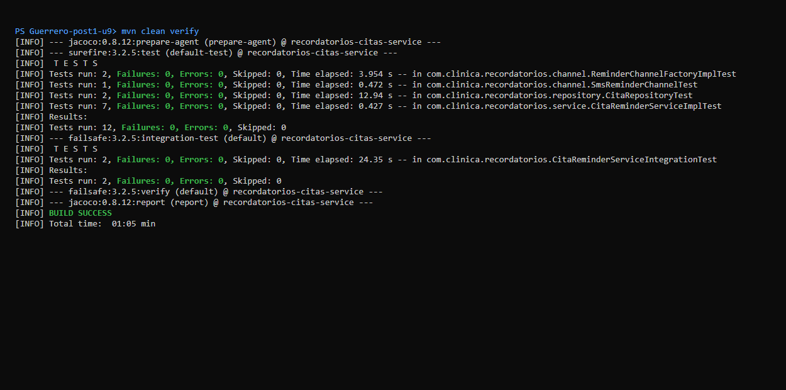
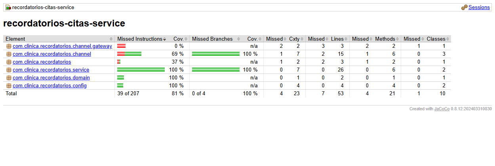
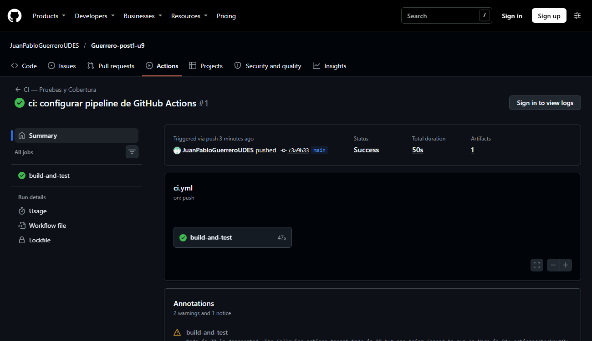

# Recordatorios Citas Service


**Autor:** Juan Pablo Guerrero Hernández · Patrones de Diseño de Software · Unidad 9 · UDES

## Descripción

Repositorio del post-contenido de la Unidad 9 de Patrones de Diseño de Software, *Probar el Diseño:
JUnit 5, Mockito, Test Doubles e Integración Continua*. Es un solo proyecto Spring Boot que envía
recordatorios de citas médicas por el canal preferido del paciente (correo o SMS). Desde el inicio se
construyó con **Strategy** (`ReminderChannel`) y **Factory Method** (`ReminderChannelFactory`), y ambos
se inyectan por constructor siguiendo el **Principio de Inversión de Dependencias (DIP)**.

```
src/main/java/com/clinica/recordatorios/
├── domain/        Cita (entidad JPA), CanalNotificacion (EMAIL, SMS)
├── repository/    CitaRepository (JpaRepository)
├── channel/       ReminderChannel (Strategy), Email/SmsReminderChannel,
│   │              ReminderChannelFactory (Factory Method) + Impl
│   └── gateway/   NotificadorSmsGateway, TwilioNotificadorSmsGateway
├── service/       CitaReminderService(Impl), CitaNoEncontradaException
└── config/        Composition root: ClockConfig, CanalUrgenteConfig

src/test/java/com/clinica/recordatorios/
├── service/       CitaReminderServiceImplTest          (unitarias, Mockito)
├── channel/       ReminderChannelFactoryImplTest, SmsReminderChannelTest
├── repository/    CitaRepositoryTest                   (@DataJpaTest + H2)
└── CitaReminderServiceIntegrationTest                  (@SpringBootTest + H2)
```

## Parte 1: pruebas unitarias con JUnit 5 y Mockito

`CitaReminderServiceImplTest` aísla `CitaReminderServiceImpl` de sus colaboradores. El servicio se
construye a mano en `@BeforeEach` con los test doubles, sin levantar Spring.

| Prueba | Qué demuestra |
|---|---|
| `enviarRecordatoriosPendientes_citaEnVentana_usaElCanalPreferido` | La Factory recibe `EMAIL`, el canal devuelto recibe el mensaje y `save()` se llama una vez con la cita marcada. |
| `enviarRecordatoriosPendientes_citasConCanalesDistintos_seleccionaUnaEstrategiaPorCita` | Cada cita se envía por *su* estrategia y nunca por la de otra cita. |
| `enviarRecordatoriosPendientes_ventanaDeterministaSegunClockFijo_consultaLosLimitesExactos` | Con `Clock.fixed`, los límites de la ventana son exactos: `2026-08-10T09:00` a `2026-08-11T09:00`. |
| `enviarRecordatoriosPendientes_sinCitasPendientes_noConsultaLaFactory` | Si no hay citas pendientes, no hay interacción con la Factory ni con `save()`. |

## Parte 2: refactor DIP, integración y CI/CD

`enviarRecordatorioUrgente` se creó con un `new` hardcodeado que impedía probarlo. El refactor llevó esa
construcción a `config/CanalUrgenteConfig.java` y ahora la abstracción se inyecta por constructor.
`CitaRepositoryTest` (`@DataJpaTest`) y `CitaReminderServiceIntegrationTest` (`@SpringBootTest`) prueban
la persistencia y el flujo completo con H2 y un `Clock` fijo. El pipeline `.github/workflows/ci.yml`
ejecuta `mvn verify` en cada push y en cada pull request a `main`.

| Prueba | Tipo | Qué demuestra |
|---|---|---|
| `enviarRecordatorioUrgente_citaExistente_usaCanalUrgenteInyectado` | Unitaria | Se usa el canal urgente inyectado (y no la Factory), y la cita se marca y se guarda. |
| `enviarRecordatorioUrgente_gatewayFalla_noMarcaComoEnviado` | Unitaria | Si el canal lanza una excepción, la cita **no** se marca ni se guarda. |
| `enviarRecordatorioUrgente_citaInexistente_lanzaCitaNoEncontradaException` | Unitaria | Un id inexistente lanza la excepción de dominio sin tocar el canal. |
| `findByFechaHoraCitaBetweenAndRecordatorioEnviadoFalse_soloRetornaCitasPendientesEnVentana` | `@DataJpaTest` | La query derivada excluye las citas ya enviadas y las que están fuera de la ventana. |
| `save_citaNueva_generaIdYPersisteElCanalComoTexto` | `@DataJpaTest` | El mapeo JPA (id IDENTITY y enum STRING) funciona sobre H2. |
| `enviarRecordatoriosPendientes_contextoCompletoDeSpring_persisteYNotificaCitasEnVentana` | `@SpringBootTest` | Recorre Factory, `SmsReminderChannel`, gateway (`@MockBean`) y H2 con los beans reales. |
| `enviarRecordatorioUrgente_contextoCompletoDeSpring_usaElBeanCanalUrgenteConGatewayMockeado` | `@SpringBootTest` | El bean `canalUrgente` de `CanalUrgenteConfig` queda bien conectado con `@Qualifier`. |

## Decisiones de diseño

### Mock vs. Stub vs. Fake para cada colaborador (Parte 1, Paso 5)

Para decidir usé la tabla de Test Doubles. Un **Stub** solo devuelve respuestas preparadas. Un **Mock**
también permite *verificar* cómo se le llamó. Un **Fake** es una implementación real y funcional, pero
simplificada.

| Colaborador | Elección | Por qué |
|---|---|---|
| `CitaRepository` | **Mock** | Un Stub no basta. Además de controlar lo que devuelve `findByFechaHoraCitaBetweenAndRecordatorioEnviadoFalse`, la prueba tiene que **verificar** que `save()` se llama exactamente una vez por cita y con `recordatorioEnviado = true`, o que *nunca* se llama si no hay citas o si el envío falla. Con un `ArgumentCaptor` también se verifican los argumentos exactos de la consulta. Cuando se necesita controlar la respuesta *y* verificar la interacción, el doble es un Mock. |
| `ReminderChannelFactory` / `ReminderChannel` | **Mock** | Lo que se prueba es la **selección de la estrategia**: que el servicio pida `obtenerCanal(EMAIL)` cuando la cita prefiere correo y que *ese* canal reciba `enviar(cita, mensaje)`. Esto no se ve en ningún valor de retorno, porque `enviar()` es `void`. Solo se comprueba verificando interacciones (`verify`, `never()`, `verifyNoInteractions`). En la Parte 2, el `canalUrgente` también es un Mock porque hace falta *programarle un fallo* (`doThrow`) y verificar que no se usó. |
| `Clock` | **Fake** (`Clock.fixed(...)`) | Lo dejé **sin mockear a propósito**. `Clock.fixed` es una implementación real y completa de `java.time.Clock` que viene con el JDK, así que `LocalDateTime.now(clock)` funciona exactamente igual que en producción, solo que con el instante congelado. Mockearlo con Mockito obligaría a stubbear `instant()` y `getZone()` por separado, y cualquier cambio interno del JDK podría romperlo. El Fake es más simple, se lee mejor y es más fiel al comportamiento real. |

### Qué patrón facilitó qué prueba

**Strategy (`ReminderChannel`) facilitó la verificación del envío.** Como todos los canales cumplen la
misma interfaz con un solo método `enviar(Cita, String)`, un `@Mock ReminderChannel` reemplaza
*cualquier* canal, sea correo, SMS o uno futuro, y la prueba verifica el envío con una sola línea
(`verify(canal).enviar(eq(cita), anyString())`). *Sin Strategy*, la lógica SMTP y la lógica HTTP del
proveedor de SMS estarían escritas dentro del servicio. Para probarlo habría que mockear librerías de
bajo nivel (`JavaMailSender`, clientes HTTP) o, peor, enviar correos y SMS de verdad. También sería
imposible escribir `enviarRecordatorioUrgente_gatewayFalla_noMarcaComoEnviado`, porque no habría una
abstracción propia a la que programarle un fallo.

**Factory Method (`ReminderChannelFactory`) hizo verificable la selección de canal.** La decisión
"¿qué canal le corresponde a esta cita?" quedó como una **interacción explícita y observable**:
`verify(reminderChannelFactory).obtenerCanal(CanalNotificacion.EMAIL)`. La prueba
`..._citasConCanalesDistintos_seleccionaUnaEstrategiaPorCita` comprueba que a cada cita le llega su
estrategia, y `..._sinCitasPendientes_noConsultaLaFactory` comprueba que no se consulta en vano.
*Sin la Factory*, el servicio tendría un `if/else` o un `switch` sobre el canal y crearía los canales
con `new`. Esa decisión solo se vería de forma indirecta, revisando la consola o el efecto secundario
real, y para probar cada rama habría que preparar infraestructura de correo y de SMS. Como la Factory
también tiene su propia prueba (`ReminderChannelFactoryImplTest`), el mapeo `EMAIL → Email` y
`SMS → Sms` se valida por separado, sin el servicio.

**DIP (inyección por constructor + composition root en `config/`) hizo posible probar el tiempo y la
integración.** Como el `Clock` llega por constructor, la prueba de la ventana de 24 horas es
determinista. Como todos los colaboradores son beans, `@SpringBootTest` puede reemplazar *solo* el
`Clock` (`@TestConfiguration` + `@Primary`) y el gateway (`@MockBean`) y dejar reales todos los demás
componentes.

### El refactor DIP (Parte 2, Pasos 7 y 8): antes y después

**Diagnóstico (antes del refactor).** La primera versión de `enviarRecordatorioUrgente` (commit
`feat(service): agregar enviarRecordatorioUrgente con new hardcodeado`) contenía esta línea dentro del
cuerpo del método:

```java
ReminderChannel canalUrgente = new SmsReminderChannel(new TwilioNotificadorSmsGateway());
```

Esa línea es la responsable de que el método no se pudiera probar. El método **elige y construye él
mismo** su dependencia concreta en cada llamada. Desde fuera no hay ningún punto (constructor, setter o
parámetro) por donde una prueba pueda pasar otro objeto, así que Mockito no tiene dónde meter un test
double. Cualquier prueba terminaría llamando al gateway "real" de Twilio, y no hay forma de simular que
el gateway falla para comprobar que la cita **no** se marca como enviada. En cambio,
`enviarRecordatoriosPendientes()` sí era testeable desde la Parte 1, porque no construye nada: usa
`citaRepository`, `reminderChannelFactory` y `clock`, que recibe por constructor, y la prueba puede
pasarle mocks y un fake. Se podría interceptar el `new` con `Mockito.mockConstruction()`, pero eso
sería ocultar con la herramienta un problema que es de diseño.

| | Antes (Paso 7): `new` hardcodeado | Después (Paso 8): inyección por constructor |
|---|---|---|
| Quién construye el canal | El propio método, en cada llamada | `CanalUrgenteConfig.canalUrgente(...)` (composition root) |
| Dependencia del servicio | `SmsReminderChannel` y `TwilioNotificadorSmsGateway` (concretas) | `ReminderChannel` (abstracción) con `@Qualifier("canalUrgente")` |
| ¿Se puede sustituir en una prueba? | No | Sí: `new CitaReminderServiceImpl(repo, factory, canalUrgenteMock, clockFijo)` |
| Escenario "el gateway falla" | No se puede probar | `enviarRecordatorioUrgente_gatewayFalla_noMarcaComoEnviado` ✅ |

```java
// Después: el único "new" de este canal vive en config/, fuera de la lógica de negocio
@Bean
public ReminderChannel canalUrgente(NotificadorSmsGateway gateway) {
    return new SmsReminderChannel(gateway);
}
```

El comportamiento externo no cambió (la integración `enviarRecordatorioUrgente_contextoCompletoDeSpring_...`
confirma que en producción se sigue enviando un SMS). Lo que cambió es **quién decide** la implementación
concreta. La prueba del fallo del gateway demuestra que poder probar el método es una consecuencia
directa de aplicar DIP.

### Por qué H2 real pero gateway mockeado (Pasos 10 y 11)

En `CitaReminderServiceIntegrationTest` conviven una base de datos real (H2 en memoria) y un `@MockBean`
sobre `NotificadorSmsGateway`, y esto no es inconsistente. H2 es un **Fake** aceptable porque cumple el
mismo contrato SQL/JPA que la base real y no necesita infraestructura. Un proveedor de SMS externo no
tiene un "H2" gratuito y determinista. Por eso se reemplaza con un **Mock**: así la prueba no depende de
credenciales, de la red ni de que el proveedor esté disponible. Gracias a H2, el workflow de GitHub
Actions **no necesita un bloque `services:`** con PostgreSQL ni Docker/Testcontainers, y el pipeline es
más simple y rápido.

Detalle técnico: en la `@TestConfiguration` el bean se llama `clockFijo` y no `clock`. Spring Boot
prohíbe por defecto sobrescribir beans con el mismo nombre, así que se usa `@Primary` para que el reloj
fijo tenga prioridad sobre el de `ClockConfig`.

## Ejecutar las pruebas

```bash
mvn test                  # Unitarias + @DataJpaTest (Surefire)
mvn verify                # Además @SpringBootTest (Failsafe) + reporte de cobertura JaCoCo
```

El reporte de cobertura queda en `target/site/jacoco/index.html`. En CI también se publica como el
artefacto `reporte-cobertura-jacoco` de cada ejecución.

Para ejecutar la aplicación usa `mvn spring-boot:run`. En Windows, si la ruta del proyecto tiene
caracteres como `ñ`, puede fallar con `ClassNotFoundException`. En ese caso usa `mvn package -DskipTests`
y luego `java -jar target/recordatorios-citas-service-0.0.1-SNAPSHOT.jar`.

## Evidencias

**Pruebas en verde (`mvn clean verify`):** 12 pruebas con Surefire y 2 con Failsafe, 14 en total, sin
fallos.



**Reporte de cobertura JaCoCo:** 81 % de instrucciones en total y 100 % en el paquete `service`
(100 % de ramas).



**Pipeline de GitHub Actions en estado "Success":**



## Herramientas utilizadas

- Java 21, Spring Boot 3.3, Spring Data JPA, H2, Lombok
- JUnit 5, Mockito, Spring Boot Test, JaCoCo
- Apache Maven (Surefire y Failsafe), GitHub Actions, Git y GitHub

## Conclusiones

Un buen diseño y la facilidad para probar el código van de la mano. Strategy y Factory Method
convirtieron "qué canal usar" y "cómo enviar" en interacciones con interfaces propias, que se verifican
con un solo mock. El `new` hardcodeado de `enviarRecordatorioUrgente` mostró lo contrario: cuando una
clase construye sus propias dependencias concretas, ni la mejor herramienta de pruebas encuentra dónde
meterse, y la solución es llevar esa construcción al composition root. También aprendí que elegir el
test double es una decisión de diseño. Un mock se justifica cuando hay que verificar interacciones, y un
fake como `Clock.fixed` o H2 es mejor cuando existe una implementación real y fiel. Por último, preferir
H2 a una base de datos en contenedor permitió tener un pipeline de CI simple, rápido y sin
infraestructura adicional.
